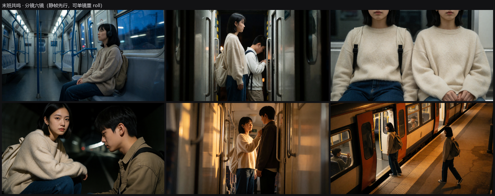

# dsh-comfyui-music-mv

音乐 MV 生成插件：一个主题进，一支带原曲的 mp4 出。


> 步骤条 + 时间轴带 + 分镜卡片。每镜可以单独重 roll 静帧、单独看片、展开改景别/运镜/灯光/景深。



> 六镜静帧：同一角色贯穿全片，景别按情绪推进变化。

## 流程（分镜先行）

```
主题
 ├─ 剧本     宿主 LLM          logline / 情绪曲线 / 结尾 / 导演阐述 / 主角外形 / 歌词 / 曲风
 ├─ 分镜     宿主 LLM          每镜 12 个结构化字段（场景 时间 景别 机位 俯仰 运镜 灯光 景深 转场 动作 对位歌词 情绪）
 ├─ 出歌     YuE2 3B          → flac（读 STREAMINFO 得精确总长）
 ├─ 定妆图   Krea2 Turbo      → 1 张主角图，全片复用，锁人物身份
 ├─ 静帧     Krea2 Turbo      → 每镜一张电影剧照【可单镜重 roll、可改参数、有版本历史】
 ├─ 视频     MiniMax H3       → 首帧=静帧，身份=定妆图，歌声=<Audio 1> 切片（对口型）
 │                              下一镜可用上一镜末帧当首帧（末帧接龙）
 └─ 合成     ConcatenateVideo → 接成整支 + 压上原曲 + 按歌长裁齐
```

**为什么先出静帧**：直接文生视频等于六次独立抽卡，人物、场景、构图都不可控，错了只能整镜重跑。
先出图把画面定死，再图生视频，成本从"每镜 5–10 分钟"降到"每镜 40 秒可审"，而且首帧就是你要的那张。

**为什么要末帧接龙**：H3 单段上限 15 秒，一支 MV 必然是 N 段拼。
把上一段最后一帧抽出来（`LoadVideo → Video Slice → GetVideoComponents → SaveImage`，不需要 ffmpeg），
当下一段的首帧，切点两侧是同一张画面，观感上就是连续的。

## 结构化镜头语言

`lib/shotlang.js` 把"景别 / 俯仰 / 机位 / 运镜 / 灯光 / 景深 / 转场"变成枚举 + 英文片段，
提示词由字段拼出来，而不是一段自由文本：

```
medium shot, waist-up to full body · eye-level shot · shooting from the front ·
slow push-in dolly · dramatic side lighting · shallow depth of field
```

灵感来自 LocalMiniDrama 的 `angleService`（8 方向 × 4 俯仰 × 3 景别）与「专业分镜」弹窗。
小模型对这类短语的反应，比"很感人的特写"稳定得多。

## 先有剧本，才有分镜

宿主 LLM 一次产出**场次体剧本**（场号 / 地点时间 / 动作 / 表演 / 声音 / 对位唱词）与 **逐镜分镜表**，
不是一句 logline。剧本层三种硬字段：

- `performance`：可拍的微动作序列（先做→停在哪→最后做），禁止"他很悲伤"这类形容词
- `objective`：这一镜他想要什么（要/不要，每镜可以相反）
- `prop`：物件母题（3–5 个实体，各被 ≥2 镜用到，末镜回到第一个）

**体检 `lintPlan` 12 项**，不过就自动返修：`repairBookend`（末镜回扣）与 `relieveSilence`（留白镜），
面板顶部显示分数与逐项 ✓/✗。

## 时间轴跟着歌走

不再平均切。副歌 ×0.62（短切）、主歌 ×1.0、桥段 ×1.3、前奏尾奏 ×1.4，再加 ±12% 抖动：

```
《骨铃》21 镜：6.6 – 15.0 秒，长短比 2.3，18 种不同长度
```

沉默那一镜会自动从相邻镜头借时间撑到 8 秒——宁可少唱一句，也要留一镜让表演自己说完。

## 长歌分段出歌

YuE2 单段实际约 108 秒（要 210 只给 130）。超过 120 秒自动分段：

```
每段 108s → 段与段 style 追加 "continuing seamlessly… same key, same tempo"
        → ffmpeg acrossfade 6 秒交叉淡化 → -t 裁到目标长度
实测 210 秒目标 → 206.20 秒（108.00 + 104.20）
```

## 静帧认人（参考图生图）

有定妆图时，静帧不再纯文生图，而是走 Qwen 编辑链路：定妆图当"演员本人"，分镜句子当"这场戏怎么拍"。

```
LoadImage(本体/人形 定妆) ×1–2 → TextEncodeQwenImage21 → KSampler → 1664×960
```

- 按镜头动作判定形态，**本体喂狗图、人形喂人形图**（喂错图，狗就被画成人）
- 两个角色同框时必须点名"这是两个不同的角色，绝对不要融合成一个"，否则会长出狗头人身的混血
- 每张约 50–70 秒，换来的是全片同一张脸、同一个项圈

## 定妆按形态拆分（原形 / 人形各一张）

角色外形常常一句话写两种形态：「中华细犬…幻化人形时为 20 岁少年…」。**整句喂给文生图，模型会揉成「长着狗耳朵的少年」**——这不是提示词措辞问题，是资产错了，后面每一张静帧都会忠实地复刻这个错误的角色。

所以 `heroFormSpecs(look)`（lib/mv.js）把外形按「幻化人形时 / 人形时 / 变作人形时」切开，分别出图并各带一句护栏：

- 原形：`只有这一个非人形态：动物或骨架本体…画面里没有任何人类、没有人的脸、没有手臂`
- 人形：`只有这一个人形：正常人类的头部与头发，画面里没有兽耳、没有尾巴、没有动物毛发`

结果写回 `job.heroes[i]`：`file/comfy` 是原形、`humanFile/humanComfy` 是前者的人形。面板上 **♻ 重出定妆**（`POST /api/comfyui-music-mv/heroes`，可只重出某一个角色 `{index:0}`）只换定妆、不动已出的静帧。

## 导演本（一键出版）

`mv_book` / 面板 **📖 导演本** / `GET /api/comfyui-music-mv/book?id=…` 会把一个任务导成**单文件 HTML**：A4 打印样式、图片全部内嵌，双击就能看，Ctrl+P 直接出 PDF。

包含：封面（片名/时长/镜数/一句话）、主创与基调（曲风、视觉基调、角色、物件母题）、三形态定妆、节奏条（纯 SVG，块宽=时长、颜色=景别）、场次体剧本（表演/声音/唱词）、分镜板、分镜表（#/时长/景别/机位/运镜/光/动作/表演/他要/道具）。

静帧原图 1–3MB，二十几张直接内嵌会做出 60MB 的 HTML，所以导出时用 ffmpeg 缩成 420–560px 的 JPEG 再内嵌（按源文件 mtime 缓存，重复导出不重转）。没装 ffmpeg 时仍能导出，只是文件会很大。

## 面板用法

1. 写主题 → 调歌长/像素/比例 → **🎬 生成剧本**
2. 改剧本、歌词、主角，展开任一镜头可改参数
3. **① 出歌 + 定妆 + 静帧** → 停下等人审
4. 不满意的镜头点 **🔄 换一张**（只重出这一张图，几十秒）
5. **② 出视频 + 合成** → 末帧接龙逐镜出片并拼成成品
6. 也可 **一键到底**

## 工具

| 工具 | 作用 |
|---|---|
| `mv_plan` | 主题 → 剧本 + 歌词 + 分镜表（只调宿主 LLM，不占 GPU） |
| `mv_render` | 后台任务；`phase=all/frames/videos`、`tailLink` 控制是否接龙 |
| `mv_status` | 查进度：阶段、每镜静帧/视频状态、成品路径 |
| `mv_stitch` | 只拼接：N 段视频 + 1 条音轨 → mp4（`trimSeconds` 裁到歌长） |

## 对口型

有台词的镜头会把整首歌按该镜的时间区间切一段，当 `<Audio 1>` 喂给 H3：

```
LoadAudio(整首) → TrimAudioDuration(start_index, duration) → SaveAudioAdvanced(flac)
```

提示词里写「严格按 <Audio 1> 的歌声对口型，唱的是『那句歌词』」。
成品音轨仍然用整首歌压一次，所以切片再准也不会把多段人声拼错。

## 转场（可选 ffmpeg）

分镜表里每镜的 `transition` 字段现在会真的执行：`cut / dissolve / fade / whip / match`。
执行它需要 ffmpeg，插件按下面的顺序找，找到就启用、找不到就退回硬切（不报错）：

```
$DSH_MV_FFMPEG   →   <插件>/.data/bin/ffmpeg.exe
                 →   ~/Documents/LocalMiniDrama/backend-node/tools/ffmpeg/ffmpeg.exe
                 →   PATH
```

拼接命令是 `xfade` 链：

```
[0:v][1:v]xfade=transition=fade:duration=0.6:offset=9.53[v1]
[v1][2:v]xfade=transition=fadeblack:duration=0.8:offset=18.85[v2] ...
[vx]tpad=stop_mode=clone:stop_duration=2.76[vout]   ← 补回被 overlap 吃掉的时长
-map [vout] -map N:a -c:v libx264 -crf 20 -c:a aac -t <歌长>
```

xfade 每接一次就少一个 overlap，所以必须用 `tpad` 补回、再用 `-t` 裁齐，
否则会出现「画面 58.6 秒、声音 60 秒」的尾巴没画面。

没有 ffmpeg 时走 ComfyUI 的 `ConcatenateVideo`，硬切 + 原曲，同样按歌长裁齐。

## 已知限制

- 对口型只保证"嘴型跟着这段歌声走"，不能保证逐字精确。
- 单镜 5–15 秒；60 秒约 6–8 镜，16 GB 显存整支可能一小时。
- 转场依赖 ffmpeg；没有它时 `transition` 字段只入库，段间一律硬切。
- 只支持 flac / mp3 读时长（flac 精确，mp3 按首帧比特率估算）。
- 全片必须同一比例/像素，否则转场/拼接会失败或重编码。
